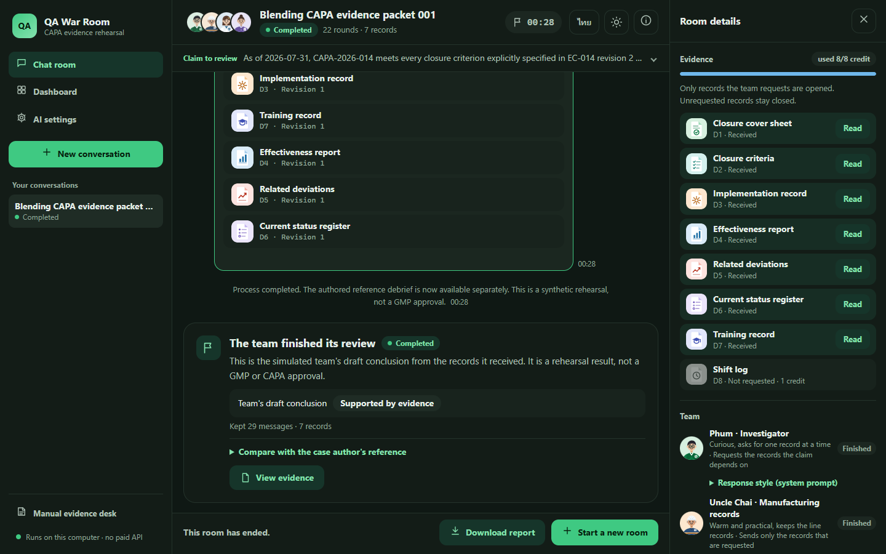
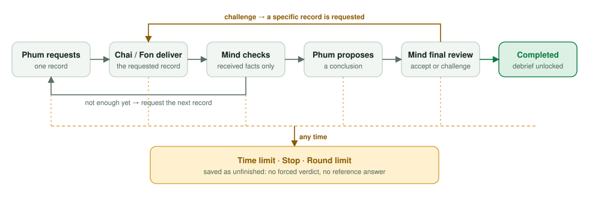
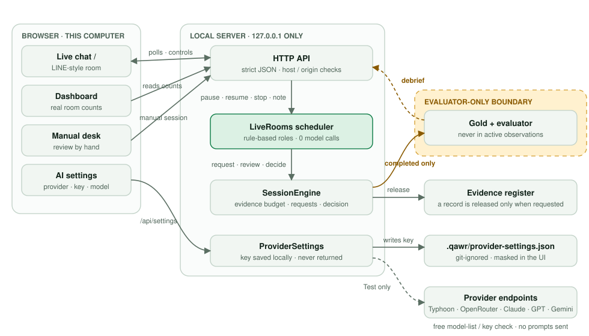
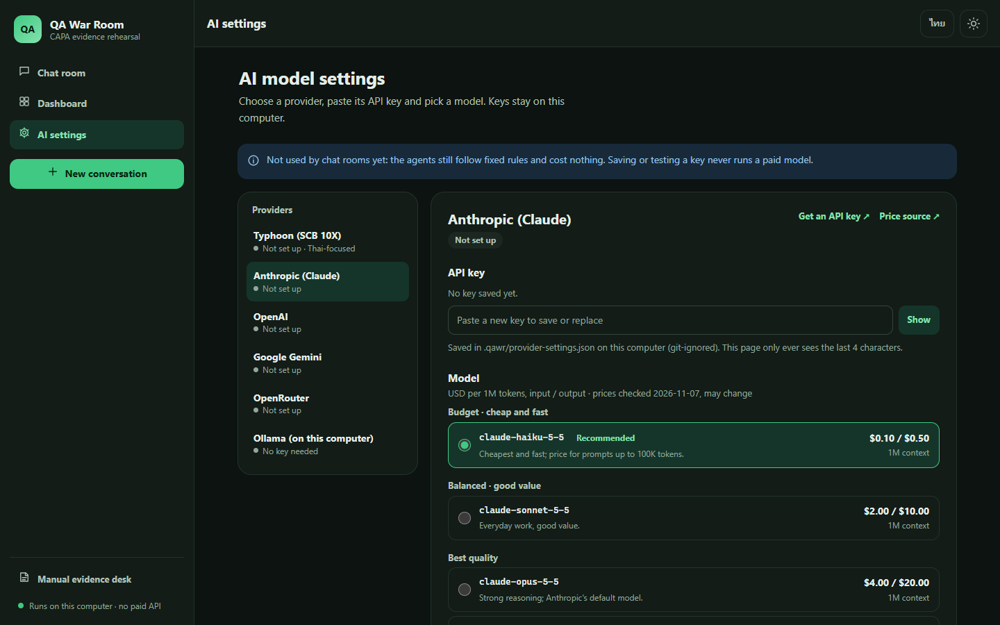

<p align="center">
  
</p>

<h1 align="center">QA War Room</h1>

<p align="center">
  <strong>Evidence-first rehearsal for Manufacturing GMP deviation and CAPA claims.</strong><br>
  Watch a simulated review team request records, check the facts and reach a conclusion, or stop honestly when the evidence or the time runs out.
</p>

<p align="center">
  
  
  
  
  
</p>

> [!IMPORTANT]
> QA War Room is a **local research prototype on fictional data**. The agents are deterministic, rule-based roles, not language models or qualified auditors. Nothing it produces is a GMP determination, a CAPA approval or a validated scientific result. Independent review is **not performed**, the reviewed reference is **not locked**, and confirmatory experiments are **not run**.

<p align="center">
  
</p>

## Why it exists

A CAPA cover sheet can say *closed and effective* while the records behind it are missing, out of scope, dated after the cutoff or simply contradictory. QA War Room turns that problem into something you can watch and measure:

- **What should a reviewer request next**, under a fixed evidence budget?
- **Is the evidence actually applicable** to the stated line, batches, procedure revision and review cutoff?
- **When is the honest answer "not enough evidence"**, and how should an unfinished review be recorded?

The product side is an interactive audit rehearsal with traceable reports. The research side studies sequential evidence acquisition, sufficiency, contradictions and selective decisions, with strict separation between what the actor can see and what only the evaluator knows.

## Highlights

| Feature | What it does |
|---|---|
| **Live review room** | A LINE-style chat where four illustrated roles (*Phum*, investigator; *Uncle Chai*, manufacturing records; *Fon*, quality records; *Mind*, evidence checker) work through a case in real time. Pause, add a note, request a record yourself, or stop. |
| **Evidence only on request** | Records are released one at a time against a budget. Attachments open only records that were actually delivered; unrequested content never reaches the room. |
| **Honest endings** | Completion unlocks the author's reference debrief. A time limit, stop or round limit saves the room as unfinished, with no forced verdict and no answer key. |
| **Real data dashboard** | Counts of rooms by status, per case, straight from the local server. No invented scores or charts. |
| **AI provider settings** | Typhoon, Anthropic, OpenAI, Google Gemini, OpenRouter or local Ollama, with 44 curated models and published prices. Keys stay in a git-ignored local file and are never sent back to the browser. *Rooms do not call models yet.* |
| **Bilingual, accessible** | Thai by default, English on demand, light and dark themes, keyboard and screen-reader labels, reduced motion, mobile layout. |
| **Research pipelines** | Native benchmark runner, a derived sequential-disclosure task, a 48-case synthetic Manufacturing GMP pack, a prospective evaluation plan and a reproducibility bundle, all offline. |

## Quick start

Requires Python 3.10 or newer. No packages, API keys or internet access are needed to run the app.

```bash
git clone https://github.com/siriponsri/QA-War-Room.git
cd QA-War-Room
python -m qa_war_room --port 8765
```

On Windows use `py -3` instead of `python`. Then open **http://127.0.0.1:8765**:

1. Pick one of eight sample cases.
2. Choose a time limit (1, 2 or 5 minutes, or a custom 1–300 seconds).
3. Press **Start conversation** and watch the team work. Download a Thai or English report at any time.

| Page | Purpose |
|---|---|
| `/` | Live review room |
| `/dashboard.html` | Rooms and status counts for this server session |
| `/settings.html` | AI provider, API key and model selection |
| `/manual.html` | The original manual evidence desk |

The server binds to localhost only. Room state lives in memory and resets when the server restarts.

## How a room works

<picture>
  <source media="(prefers-color-scheme: dark)" srcset="docs/assets/room-flow-dark.svg">
  
</picture>

The scheduler runs on the server, so a room keeps going even if the browser tab is closed. The wall-clock limit keeps running while a room is paused. Hard limits: 80 automatic phases, 20 notes and 40 control actions per room; four unfinished rooms at once; 50 rooms per server process.

Each character's on-screen voice is a deterministic template over the backend message. Every record ID, revision, date, verdict and rationale is copied verbatim, and the original system wording is one click away. See [docs/AGENT_PERSONAS.md](docs/AGENT_PERSONAS.md).

## Architecture and data boundaries

<picture>
  <source media="(prefers-color-scheme: dark)" srcset="docs/assets/architecture-dark.svg">
  
</picture>

Design rules that the code and tests enforce:

- **Observation isolation.** Gold labels, reference rationales, unrequested records and evaluator outputs never enter active-session responses. Only the evaluator reads gold.
- **Budgets are conserved.** Requests are idempotent; invalid references and extra request fields are rejected.
- **Missing is not failing.** Absent or out-of-scope evidence is reported as insufficient, never as proof of a violation.
- **No silent spend.** The default cost cap is zero. Saving or testing an API key calls only free model-list or key-check endpoints.

## AI provider settings

`/settings.html` stores one configuration per provider:

| Provider | Key | Test connection uses | Example picks (USD per 1M tokens, in / out) |
|---|---|---|---|
| Typhoon | yes | `GET /v1/models` | `typhoon-v2.5-30b-a3b-instruct` (Thai-first) |
| Anthropic | yes | `GET /v1/models` | `claude-haiku-5-5` $0.10 / $0.50 · `claude-sonnet-5-5` $2 / $10 · `claude-opus-5-5` $4 / $20 |
| OpenAI | yes | `GET /v1/models` | `gpt-5-nano` $0.05 / $0.40 · `gpt-6-luna` $0.10 / $0.50 · `gpt-6.1-terra` $1 / $5 |
| Google Gemini | yes | `GET /v1beta/models` | `gemini-2.5-flash-lite` $0.10 / $0.40 · `gemini-3.8-flash` $0.75 / $3.75 |
| OpenRouter | yes | `GET /api/v1/key` + public model list | 20 curated models across Claude, GPT, Gemini, DeepSeek, Mistral and Grok, plus the full live list |
| Ollama | no | `GET /api/tags` on loopback | `qwen3:8b`, `gemma4:12b`, `llama3.1:8b` (free, local) |

Prices are a snapshot checked on 2026-11-07 against each provider's published pricing (sources are linked in the UI) and will change. Keys are written to `.qawr/provider-settings.json`, which is git-ignored; the browser only ever sees the last four characters. Live rooms do not use these settings yet. Connecting them requires an explicit budget and a model adapter that keeps the isolation rules above.

<p align="center">
  
</p>

## Research programme

| Stage | What exists | Status |
|---|---|---|
| G1–G2 | Native benchmark runner with checkpoint, replay and a separate scorer | Implemented; offline wiring checks only |
| G3 | Derived sequential-disclosure task with source-family splits | Implemented; offline policies, zero API cost |
| G4 | 48 original synthetic Manufacturing GMP cases, rubric and blinded review packets | Draft references; **independent review not performed** |
| G5 | Prospective evaluation plan, input-only locks, matched-budget engineering runs | Engineering lock only; **scientific lock refused by design** |
| G6 | Local manuscript draft and reproducibility bundle with fresh-directory rehearsal | **Local draft**; no submission |
| Product | Live room, dashboard, manual desk, AI settings | Implemented and browser-tested |

Commands for every pipeline are in [docs/RESEARCH_GUIDE.md](docs/RESEARCH_GUIDE.md). The protocol and metrics are defined in [GOAL.md](GOAL.md), [PLAN.md](PLAN.md), [docs/RESEARCH_PROTOCOL.md](docs/RESEARCH_PROTOCOL.md) and [docs/EVALUATION_SPEC.md](docs/EVALUATION_SPEC.md).

## Testing

```bash
python -W error::ResourceWarning -m unittest discover -s tests -v
```

The suite (195 tests) covers observation isolation, budget accounting, end-of-episode transitions, record applicability, provenance, grouped splits, HTTP host/origin/payload limits, live-room deadlines and caps, and provider-settings secret handling. Provider tests use a fake transport and never touch the network.

An optional browser acceptance check drives a local Chrome or Edge against a running server. It needs Node 22+ and no npm packages:

```bash
node scripts/ui_browser_check.mjs --out runs/ui-check
```

It covers both languages and themes at desktop and mobile sizes, a completed room, a timeout, pause/resume, notes, manual requests, the record viewer, downloads, error states, dashboard counts, persona voices and the settings page. It creates a few in-memory demo rooms on the target server.

## Repository layout

```text
qa_war_room/            Python package (standard library only)
  server.py             localhost HTTP server and API routes
  engine.py             session engine: budget, requests, decisions
  live_room.py          background scheduler for live rooms
  provider_settings.py  local API-key storage and free connection tests
  native*.py, sequential*.py, pharma*.py, study*.py, publication*.py
                        research pipelines (G1–G6)
  static/               live room, dashboard, settings and manual desk (HTML/CSS/JS)
data/demo/              eight original synthetic demo cases (+ demo evaluator files)
docs/                   product, research, evaluation and decision records
docs/assets/            logo, diagrams and screenshots used here
manuscript/             local manuscript draft sources (not submitted)
scripts/                benchmark preparation, asset generators, browser check
tests/                  unit and HTTP tests
```

Benchmark downloads, derived datasets, run outputs, reports, PDFs and local secrets are excluded from version control.

## Documentation

| Topic | Read |
|---|---|
| Current state and verification | [STATUS.md](STATUS.md), [VALIDATION.md](VALIDATION.md) |
| Live room and personas | [docs/LIVE_ROOM.md](docs/LIVE_ROOM.md), [docs/AGENT_PERSONAS.md](docs/AGENT_PERSONAS.md) |
| Product and users | [docs/PRODUCT_SPEC.md](docs/PRODUCT_SPEC.md), [docs/BUSINESS_PRODUCT_MAP.md](docs/BUSINESS_PRODUCT_MAP.md) |
| Architecture | [docs/ARCHITECTURE.md](docs/ARCHITECTURE.md) |
| Data and cases | [docs/DATASET_PLAN.md](docs/DATASET_PLAN.md), [docs/MANUFACTURING_CASE_PACK.md](docs/MANUFACTURING_CASE_PACK.md), [docs/PHARMACEUTICAL_CASE_SPEC.md](docs/PHARMACEUTICAL_CASE_SPEC.md) |
| Evaluation and review | [docs/EVALUATION_SPEC.md](docs/EVALUATION_SPEC.md), [docs/G5_EVALUATION_PLAN.md](docs/G5_EVALUATION_PLAN.md), [docs/INDEPENDENT_REVIEW_PLAN.md](docs/INDEPENDENT_REVIEW_PLAN.md) |
| Reproducibility | [docs/REPRODUCIBILITY.md](docs/REPRODUCIBILITY.md), [docs/G6_REPRODUCIBILITY.md](docs/G6_REPRODUCIBILITY.md) |
| Decisions | [docs/DECISIONS.md](docs/DECISIONS.md) |
| Working with coding agents | [AGENTS.md](AGENTS.md), [HANDOFF_BACK_TO_CODEX.md](HANDOFF_BACK_TO_CODEX.md) |

## Limitations

- All organizations, people, records and results are fictional. No real company data is included or supported without an agreed processing setup.
- The eight demo cases and their policies were authored together, so demo scores are engineering checks, not evidence of capability.
- There is no production authentication, durable audit trail, electronic signature or eQMS integration. Multi-user hosting would need access control, persistence and validation.
- The green and white palette is an original design inspired by the owner's preference. No official logo, brand colour or institutional affiliation is claimed.

## License

The owner has not chosen a license yet (see [LICENSE_DECISION.md](LICENSE_DECISION.md)). Until then, all rights are reserved. Third-party benchmarks and publications keep their own licenses and are not redistributed here.
