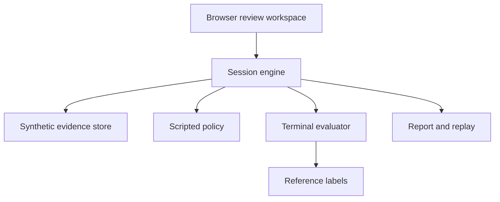

# Architecture and implementation map

## Implemented offline path

The browser calls a localhost HTTP API. The session engine validates actions and budgets. A fixture store provides only requested evidence. The evaluator separately reads reference labels after submission. Reports include the received evidence and event trail.

The policy receives a copied public observation. It has no runtime store/evaluator parameter. The evaluator is not an LLM. Repository files remain readable to the developer; the separation protects runtime interfaces, not against a person opening local gold files.

## G5 offline study boundary

`study_plan.py` validates the prospective JSON plan and freezes the complete input-only engineering matrix. `study_runner.py` gives `study_policies.py` only copied observations through the G4 engine, journals bounded normalized actions and replays against original source responses. `study_analysis.py` first replays without invoking a policy, then joins gold in an evaluator-only namespace and exports fixed-denominator diagnostics. `study_metrics.py` contains pure endpoint/paired-family arithmetic and no file access. Scientific inference remains withheld and the author-draft pack cannot pass the confirmatory-lock gate. See [G5_EVALUATION_PLAN.md](G5_EVALUATION_PLAN.md). This CLI path has no new browser integration.

## Core files

| File | Responsibility |
|---|---|
| qa_war_room/store.py | Validate/load synthetic fixtures and expose public catalogs |
| qa_war_room/engine.py | Session lifecycle, evidence requests, budget, decisions and reports |
| qa_war_room/evaluation.py | Reference verdict/set coverage after termination |
| qa_war_room/policies.py | Four deterministic scripted auditor policies |
| qa_war_room/benchmark.py | Reproducible engineering episodes, no scientific inference |
| qa_war_room/server.py | Local API, static allowlist, bounded requests, origin/host restrictions |
| qa_war_room/static/ | Browser UI without external dependencies |
| data/demo/evaluator/gold.json | Transparent demo reference decisions; not model input |
| scripts/prepare_benchmarks.py | Official input/gold separation and source checksums |
| qa_war_room/native_data.py | Checked native inputs, canonical DrugQA prompt and document-local BM25 |
| qa_war_room/models.py | Narrow model protocol, strict native output validation and offline wiring fake |
| qa_war_room/native_runner.py | Frozen cohort, append-only reservation/usage ledger, resume and separate evaluator entry point |
| qa_war_room/native_metrics.py | Native classification/ranking/MCQ metric subset with failure denominators |
| qa_war_room/native.py | Separate run/score CLI, offline adapters only |
| literature/native-protocol-lock.json | Pinned prompt/parser/evaluator source URLs, byte counts and hashes |
| qa_war_room/sequential_data.py | Gold-free controlled disclosure, exact source reconstruction, family/split/lineage mapping and private record store |
| qa_war_room/sequential_engine.py | Strict request/submit/abstain actions, credit/source-byte accounting and visible-only observations |
| qa_war_room/sequential_policies.py | Three observation-only offline wiring policies; no hidden source search |
| qa_war_room/sequential_runner.py | Frozen source/policy/budget matrix, durable transitions, checkpoint/resume and gold-free replay |
| qa_war_room/sequential_eval.py | Separate native-reference preparation, source/selective metrics and oracle coverage-proxy reachability |
| qa_war_room/sequential.py | G3 prepare/run/replay/inspect/score CLI |
| qa_war_room/pharma_authoring.py | Original fictional family/SOP/input generation, no assigned reference labels |
| qa_war_room/pharma_rules.py | Explicit structured synthetic-site criteria and scope/time applicability |
| qa_war_room/pharma_engine.py | Checked input store and gold-free budgeted acquisition with exact document pointers |
| qa_war_room/pharma_eval.py | Separate author-draft references, pair uncertainty and terminal-only evaluation |
| qa_war_room/pharma_runner.py | Scripted full-packet engineering walkthrough and source-verified replay |
| qa_war_room/pharma_review.py | Blinded alias export, blank review forms and immutable structural intake, no gold reads/promotion |
| qa_war_room/pharma.py | G4 local CLI; no new browser routes |

## API

| Route | Purpose |
|---|---|
| GET /api/health | Runtime mode/version |
| GET /api/cases | Case objective and public inventory metadata |
| GET /api/personas | Six named role policies |
| POST /api/sessions | Create session using case_id and optional auditor_role |
| GET /api/sessions/{id} | Public session observation |
| POST /api/sessions/{id}/request | Request one evidence_id; repeat is idempotent |
| POST /api/sessions/{id}/step | Execute one scripted action on the same budget |
| POST /api/sessions/{id}/decide | Submit verdict, evidence_ids and rationale; finish episode |
| GET /api/sessions/{id}/report?format=json | Download completed report |
| GET /api/sessions/{id}/report?format=markdown | Download human-readable completed report |

The verdict is a relationship between a claim and applicable evidence: supported, contradicted or insufficient. It is not a regulator's compliance determination.

## Implemented native increment

The native CLI now has an independent run path and score path. The run path reads only checked input files, freezes document-grouped cohorts, builds a detached request and calls the offline adapter under explicit resource caps. It never opens evaluator gold. The score path checks the frozen manifest/ledger, opens gold and writes separate per-dataset metrics. Its full-context and document-local retrieval paths are native-task engineering baselines, not sequential adaptations. See [NATIVE_BENCHMARK.md](NATIVE_BENCHMARK.md).

The adapter contract receives neither the fixture store/evaluator nor filesystem/tool capabilities. Provider code is not implemented; non-offline identities are refused. Failed and interrupted calls are retained, with conservative usage when unknown. Run manifests/logs are durable local files; browser sessions remain in memory.

## Next architecture increment

G4's original synthetic Manufacturing GMP pack and independent-review preparation now exist separately; see [MANUFACTURING_CASE_PACK.md](MANUFACTURING_CASE_PACK.md). Input construction, runtime observations, authoring lineage, candidate references and blinded human materials have distinct interfaces. Current references are author-defined structured-rule candidates, not independently reviewed domain gold. The review intake preserves original ratings and cannot promote form completeness to validation. Browser integration remains a separate product increment.

G3's offline controlled-disclosure environment is now implemented; see [SEQUENTIAL_BENCHMARK.md](SEQUENTIAL_BENCHMARK.md). Its store can read private records to service a request, while its policy receives only a detached observation. Gold is loaded separately after the visible trace is frozen/replayed. Original source labels, observed-reference coverage and oracle diagnostics remain distinct. G3 currently runs through its CLI/Python API, not new browser routes.

After provider/model/budget authorization, implement one real provider behind the existing native adapter contract. A later model-backed interactive controller can use G3's existing validated request/submit/abstain schema. Do not give it filesystem, arbitrary HTTP, evaluator or secret access. Provider credentials stay server-side and outside logs. If a record includes instructions to ignore controls or call a tool, it remains quoted evidence data.

Represent evidence at three levels: document identity/provenance, exact cited span/row, and claim-to-evidence relationship. A valid ID establishes provenance only; the semantic relationship needs evaluation. Add a rule layer for scope, lot, product, line, timestamp and procedure revision. Keep current synthetic reference coverage available as a regression check while adding semantic assessment separately.

Use append-only run records with actual model/prompt versions and cost accounting. The current in-memory sessions are lost on restart; no production audit-trail integrity or authentication is claimed. A persistence layer requires explicit migrations and session access controls before multi-user hosting.

## Expansion boundaries

A report is a draft/review artifact. It does not write to an eQMS or close a real CAPA. A future integration should first import de-identified documents read-only with provenance and intended-use validation. An operational twin needs a defined real counterpart and update/fidelity validation. RL requires a stable environment and credible reference outcomes; it should not be used to disguise a missing task definition.
