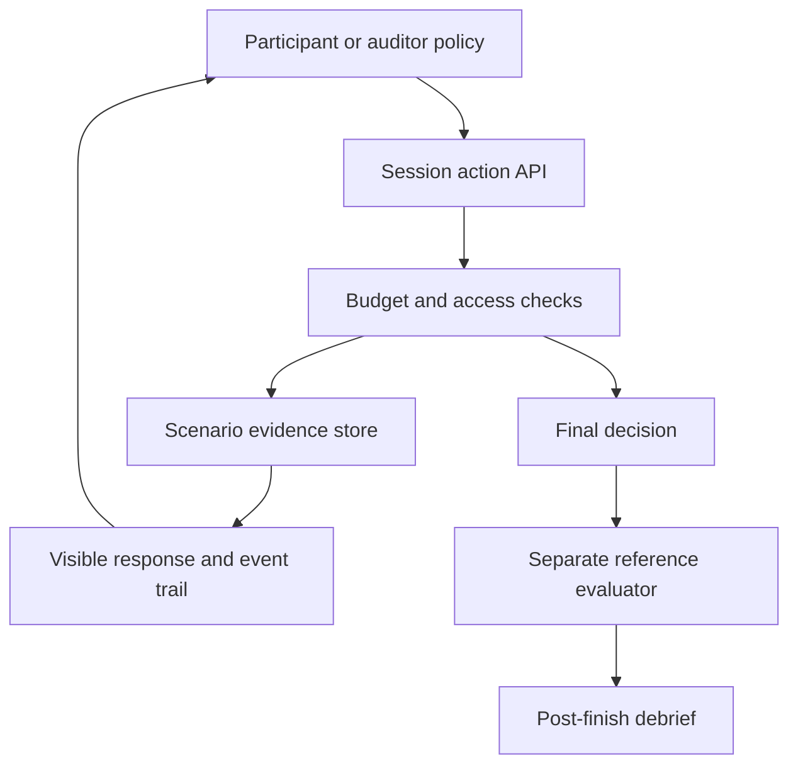

# QA War Room — product specification

**Revision:** starter 0.1, 7 November 2026  
**Owner:** Siripon  
**Scope decision:** Manufacturing GMP  
**Delivery constraint:** one primary builder; open, paper-backed datasets first; product and research developed together.

## 1. Product purpose

QA War Room is an evidence investigation workspace for pharmaceutical quality scenarios. The first task is deliberately narrow: assess whether a **specific deviation/CAPA closure claim is justified by the records available at a defined time**. The participant chooses which records to request, reads the responses, identifies scope or time mismatches, and submits a supported, contradicted, or insufficient-evidence decision with citations.

The product should make an investigation inspectable. A useful session ends with the claim, requested records, missing responses, evidence citations, reasoning, and the sequence of actions in one report. In a training setting, an authored reference answer and debrief can then be revealed. In a future readiness-review setting, the output would be a draft for a qualified reviewer, with uncertainty and missing records visible.

The central product question is: **What evidence would change this decision?** The central research question is whether an evidence-acquisition policy improves justified decisions under a fixed acquisition budget. Neither question requires a large animated game, six separately trained models, or reinforcement learning in the first implementation.

## 2. Scope and status

This document separates the starter's implemented workflow from the intended product. The project-level validation report is the authority for which checks have actually been run.

| Area | Starter implementation | Next usable capability | Evidence required before a stronger claim |
| --- | --- | --- | --- |
| User experience | Local browser workspace; case selector; evidence register; document viewer; decision form; session trail | Search within retrieved evidence, span selection, richer debrief | Usability observation on representative tasks |
| Case content | Authored, fictional manufacturing examples | Versioned, pharmaceutical scenario benchmark with reviewed labels | Domain review, annotation protocol, held-out case families |
| Evidence access | Catalog metadata before requests; content only after requests | Role-specific permissions and structured record search | Access-control and information-leakage tests |
| Agent behavior | Deterministic scripted auditor policies | A model-backed single auditor with a constrained action interface | Reproducible baseline runs and grounded-citation checks |
| Roles | Six named personas, including two records owners and four auditor policies | Distinct information access, memory, and policy constraints | Ablations showing whether each distinction helps |
| Evaluation | Authored verdict comparison and reference-set coverage | Span-level evidence sufficiency, counterfactual consistency, cost and uncertainty analysis | Validated gold labels and independent evaluation |
| Reports | Session JSON and Markdown after completion | Evidence-linked draft checklist and review queue | Source traceability, reviewer corrections, audit history |
| Twin | A synthetic case world with state | Versioned process/evidence model linked to an actual process | Defined synchronization and fidelity; external validation |
| RL | Not implemented | Optional action-policy optimization after baselines | Reliable reward, budgeted evaluation, independent test set |

The current app does not run a language model. Its “expert” names are policy labels inherited from the proposed role-play design. The starter does not establish that those policies behave like qualified pharmaceutical auditors.

## 3. Initial users and jobs

These are target-user hypotheses to validate, not evidence of demand.

| User hypothesis | Job to be done | Useful first deliverable |
| --- | --- | --- |
| QA trainee or newly assigned auditor | Practice requesting and interpreting relevant records | A replayable case with a concise, evidence-grounded debrief |
| Experienced QA reviewer or trainer | Explain why a closure package is incomplete or internally inconsistent | A case authoring/review template and a reproducible reference answer |
| Deviation/CAPA coordinator | Prepare a packet for human review and locate missing support | A source-linked readiness checklist with unresolved questions |
| Pharmaceutical organization evaluating AI | Compare models or policies against realistic, controlled cases | A benchmark runner, versioned test cases, and an error report |
| Researcher | Test evidence acquisition and decision sufficiency without private company records | Open adapters, controlled scenarios, baselines, and reproducible outputs |

The solo project's first usable audience is the builder and a small group of volunteer reviewers using synthetic records. A live organizational pilot adds requirements for data ownership, access, model-provider terms, and review workflow; it is a separate milestone.

## 4. The first workflow

### 4.1 Start an investigation

The participant selects a case and an auditor policy. The app shows a plain-language brief, the exact claim to assess, the fictional “as of” date, and the evidence-request budget. The case title must not disclose the answer. The brief should not say that a missing record is missing before the participant requests it.

A session freezes its case version, role identifier, initial budget, and event order. Starting a new session creates a new attempt; it does not rewrite an old attempt into a more favorable history.

### 4.2 Request evidence

The catalog contains neutral metadata: record ID, document type, title, owner, date, revision, and acquisition cost. The participant chooses a record. The server determines the response and records the cost. Contents are unavailable until that request succeeds.

An authored case may return no record. The UI must describe that response accurately, without turning it automatically into a regulatory violation. An unanswered request can justify further questions or an insufficient-evidence assessment; the correct interpretation depends on the defined claim and evidence rules.

Reopening a previously requested record is free. Repeating an already fulfilled request must not consume the budget again. A new request exceeding the remaining budget is rejected. The displayed budget is server-derived; a client-side edit cannot create additional credits.

### 4.3 Read, compare, and cite

The reader displays the record text and provenance metadata. The participant can compare dates, lot/cohort scope, revision status, findings, implementation actions, and the stated effectiveness criteria. A certificate or a completed training attendance sheet can be relevant, but its title alone is not proof that a corrective action was effective.

The starter displays record-level citations. The next research version should support exact text spans, table rows, and time ranges. This distinction matters: successfully linking a document ID proves traceability to a record; it does not prove that the cited text entails the decision.

### 4.4 Assess the claim

The decision choices describe evidence status, not a legal determination:

| Choice | Meaning within this task | Common error to guard against |
| --- | --- | --- |
| Supported | The obtained evidence satisfies the predefined support conditions for this claim | Treating completed paperwork as proof of effectiveness |
| Contradicted | The obtained evidence refutes the claim under the scenario's rules | Calling every absent document a contradiction |
| Insufficient | The obtained records do not justify support or contradiction | Using abstention to avoid every difficult decision |

The decision form requires a reasoning note. Supported and contradicted submissions require at least one retrieved citation. The backend rejects citations to unknown or unrequested records. Insufficient-evidence decisions can be made without citations, but a reference-set coverage check may still be incomplete if the authored case expects an available source establishing the limitation.

### 4.5 Finish and debrief

Finalization ends the attempt. Only then does the server return the authored reference verdict and explanation. The debrief shows verdict agreement and reference-set coverage separately. It must not display a single “auditor competency” score derived from these two engineering checks.

The report includes the case/version context, selected role, budget, event trail, returned evidence, decision, citations, and post-finish feedback. A user can download JSON for analysis and Markdown for inspection. The UI describes the reference answer as authored demo material, not a validated pharmaceutical gold standard.

## 5. Role design

The six role names are stable identifiers, not six required model deployments.

| Identifier | Intended role | Information and behavior design |
| --- | --- | --- |
| `user-01` | First records owner | Returns assigned artifacts or the authored unavailable response; should not see the evaluator's answer |
| `user-02` | Second records owner | Provides another controlled records source; future scenarios can introduce cross-owner inconsistencies |
| `auditor-newbie-01` | Simple auditor baseline | Uses a transparent, limited acquisition strategy |
| `auditor-newbie-02` | Alternative simple baseline | Differs by an explicit policy rule rather than a prompt claiming low expertise |
| `auditor-expert-01` | Structured auditor policy | Prioritizes defined evidence dependencies; must not read hidden gold |
| `auditor-expert-02` | Alternative structured policy | Tests another transparent strategy or corroboration rule |

The actual scripted strategies are documented in the engine code and benchmark output. The table describes product intent; it does not establish equivalence to human junior or expert auditors.

For a future model implementation, one model may instantiate all roles. Each instance still needs separate context and allowed evidence. Generating six messages with different names in one shared prompt is not a demonstration of independent expertise. A same-budget single-agent baseline is essential before attributing a benefit to the role structure.

## 6. Interaction modes

### Starter: manual investigation with optional scripted steps

The participant controls evidence requests and decisions. “Take one scripted step” delegates one action to the selected deterministic policy using the same session and budget. The participant can take over again immediately. The UI never calls this an AI response.

### Next: watch a model-backed investigation

A watch mode should expose each evidence request, the returned record, the cost, and the final justification. It should allow pause and human takeover between actions. The public trace should contain concise decision rationales and cited evidence, not a request to reveal a model's private chain of thought.

### Research: compare policies

The comparison view should run different policies from fresh sessions over the same held-out cases, budgets, and permitted evidence. Random seeds and model versions must be recorded. A side-by-side replay is useful for debugging; aggregate results require separate statistical analysis.

### Later: review an organization's packet

An evidence-readiness mode can accept the organization's own controlled documents and produce draft questions and findings. It has a different truth model from the simulator: the system often cannot know what unsubmitted records exist, and cannot reveal an authored answer. Reports must preserve that distinction.

## 7. Information boundaries

The frontend receives no reference verdict or evaluator explanation while the session is active. “Hidden” means withheld from the acting agent and public API, not inaccessible to the developer who owns the local repository. A distributable offline benchmark cannot promise cryptographic secrecy from its operator.

The local demo server binds to loopback by default. It is a development application, not a hosted multi-tenant service. Before organizational use, access control, retention, model-provider routing, tenant separation, secure deployment, and administrative review must be designed for that deployment. Those needs do not justify blocking synthetic offline development now.

## 8. Product outputs

### 8.1 Evidence-linked checklist

Each future checklist item should include a scoped question, assessment status, cited spans, source version/date, missing evidence, contradictions, and a reviewer action. It should not silently map the starter's three epistemic labels into compliant/non-compliant/not-applicable. Applicability is a separate, explicit decision.

### 8.2 Draft finding

A draft finding should state the observation, exact supporting records, the versioned requirement or scenario criterion, the bounded conclusion, and remaining uncertainty. The reviewer must be able to inspect and correct each part. Severity should not be invented from an LLM's confidence score.

### 8.3 Investigation replay

The replay should answer who requested which record, when, at what cost, and how the new evidence changed the decision. A later replay may compare the actual sequence with a lower-cost valid sequence. It should not imply that the shortest path is always the best real audit procedure.

### 8.4 Process/evidence model

A process model can connect a deviation, affected process or lot, investigation, assigned action, implementation record, effectiveness criterion, follow-up result, and closure approval. Calling it a validated operational digital twin would require an actual counterpart, a defined synchronization mechanism, and evidence of fidelity. The starter supplies a synthetic case world only.

## 9. Prioritized backlog and acceptance criteria

| Milestone | Product work | Acceptance evidence |
| --- | --- | --- |
| M0 — runnable starter | Local app, authored cases, scripted steps, bounded evidence access, reports | Fresh-start instructions work; meaningful engine and API tests pass; browser flow works |
| M1 — reproducible baselines | Open-data adapters; official and derived-task separation; frozen run configuration | Dataset provenance and licenses recorded; group splits checked; baseline command reproduces an output artifact |
| M2 — grounded model | Single-agent adapter; structured actions; citation/span output; abstention | No gold in model context; malformed actions handled; evidence decisions evaluated against held-out labels |
| M3 — manufacturing evidence benchmark | Reviewed case families; counterfactual pairs; negative and ambiguous cases | Annotation agreement and adjudication documented; domains and exclusions explicit |
| M4 — useful training prototype | Replay/debrief; human takeover; reviewer correction; reusable case packs | Representative users complete tasks; observed failures and revisions recorded |
| M5 — research comparison | Same-budget baselines, ablations, uncertainty and error analysis | Manuscript claims trace to versioned run artifacts and statistical results |
| M6 — private organizational pilot | Controlled import, access policy, reviewer workflow, logging | Partner accepts scoped pilot protocol; outputs reviewed before any operational decision |
| M7 — optional RL/twin work | Trainable action policy or synchronized process model | A specific unresolved problem and evaluation show why this added complexity is useful |

The milestones are evidence gates, not a commitment that a solo builder can complete each in a fixed number of weeks. If M2's simple baseline works well, the product can progress without RL. If a multi-agent design adds cost without a reliable benefit, keep the simpler policy.

## 10. UX acceptance criteria

- The claim, decision date, and remaining budget remain easy to locate during an investigation.
- Before a request, only catalog metadata is visible; the UI does not hint at the answer through color, ordering, or titles.
- After a failed action, the rationale and selected citations remain intact.
- A no-record response is visibly different from a retrieved document and from a network error.
- All supplied text is rendered as text; source content cannot inject HTML or scripts.
- Keyboard users can select a case, request records, choose citations, submit a decision, and download a report.
- Narrow screens retain the complete workflow without horizontal document-panel overflow.
- In-progress and completed sessions are visually distinct; completed sessions cannot acquire new evidence.
- The app states that it is offline/scripted whenever no model is connected.
- Reference-set coverage is not labeled as semantic correctness, professional qualification, or regulatory compliance.

## 11. Product instrumentation

The first useful measurements are request order, cost, returned/unavailable artifacts, decision time, cited records, verdict, and post-finish reference comparison. Add exact source spans and model tokens/cost only when those components exist.

Avoid optimizing a product dashboard for the number of findings. More findings can mean more false allegations. The proposed outcome is fewer unjustified closure decisions and fewer unsupported findings at a comparable effort, while retaining useful coverage. Product claims about time saved or learning gains require an appropriate user study; simulator traces alone cannot establish either.

## 12. Decisions that can wait

The starter does not require a chosen model vendor, cloud hosting, a paid subscription system, a production LIMS/QMS connector, a company document corpus, or six model checkpoints. Choose those when an evidence gate identifies a concrete need.

Before a live pilot, the owner should decide the target manufacturing process, intended user, regulatory scope/version, permissible data routing, availability of independent domain reviewers, and the acceptable reviewer workload. These are material deployment and study design decisions, not reasons to delay the open, synthetic prototype.

## 13. Implementation handoff

The static client is in `qa_war_room/static/`. It uses the server's JSON API without a frontend build step or third-party web resources. `index.html` contains the accessible page structure, `styles.css` defines the responsive visual system, and `app.js` manages the session UI.

The API is documented and tested in the engine portion of the repository. The client relies on server-side enforcement of costs, session status, allowed evidence, and reference-answer release. Do not move these rules into the browser merely to simplify an implementation.

When adding an LLM, keep the world engine deterministic and expose its constrained action API to the model. Use the same interface for manual participants, scripted baselines, and model policies. This makes product debugging and experimental comparisons refer to the same behavior.
