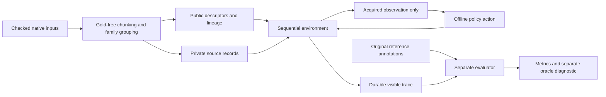

# G3: controlled sequential evidence acquisition

Task ID: `qawr-contractnli-sequential-v1`. Status: implemented offline engineering task, 7 November 2026. This is a separately named derived task, not a native ContractNLI score, a Manufacturing GMP benchmark, or pharmaceutical validation.

## Purpose and acceptance

The developer needs to observe what a policy actually acquired before judging its answer. This increment provides an executable request/submit/abstain environment, visible-only policy paths, durable replay, family-grouped partitions, and a separate evaluator with budget reachability diagnostics. Acceptance checks cover isolation, original-source reconstruction, strict actions/citations, accounting, grouped descendants, resume/replay, and fixed-denominator metrics. A correct guessed label must not automatically count as a justified decision.

The existing localhost CAPA demo and native CLI remain available. G3 is currently a separate CLI and Python environment API; it has not been added to the browser UI. No provider, paid API, LLM, training, tuning, counterfactual relabeling or domain review is involved.

## Task contract

| Component | Frozen v1 behavior |
| --- | --- |
| Source | The already checked ContractNLI train/dev/test prepared inputs and unchanged original labels |
| Initial observation | Original hypothesis, source/task ID, null assessment date, generic record inventory, budget, empty evidence/response ledger |
| Initially visible record metadata | Local ordinal ID, generic title, uniform cost 1, requested flag |
| Hidden until acquisition | All record/span text, character offsets, content hash, record source size, detailed provenance |
| Evidence units | Four successive original spans per record by default; include intervening text, header and footer so every source character is preserved |
| Segmentation | Input-only, before loading reference annotations; no gold-selected boundaries, ranking, titles or initial evidence |
| Acquisition | Request exactly one named record; no free search, rerank or scan over hidden source text |
| Source budget | Acquisition credits and unique UTF-8 source bytes returned, separately capped |
| Terminal actions | Submit a native three-way label with visible-span citations, or explicitly abstain with a forced native label |
| Evaluation | Source label correctness and observed/cited published-reference coverage reported separately |

Character offsets use Python Unicode code-point indexing, matching the prepared source convention. Records concatenate to the exact original text. Each original span belongs to one record; gaps are retained with adjacent text. Empty/overlapping source-span structures are rejected rather than silently rewritten.

No assessment date, manufacturing scope or regulatory requirement is invented for contracts. The initial record order is source order and generic titles do not describe the outcome. A source ID may be public in the original benchmark; runtime separation prevents supplying the local answer key, not an owner manually finding the public source.

### Action schemas

```json
{"type":"request","record_id":"R0001"}
```

```json
{"type":"submit","label":"Entailment","citation_span_ids":[0],"rationale":"A short explanation based on acquired text."}
```

```json
{"type":"abstain","forced_label":"NotMentioned","reason":"No adequate visible evidence."}
```

Fields are exact. Labels remain Entailment, Contradiction and NotMentioned. NotMentioned is a source-level class and never a substitute for abstention. Citation IDs must be unique integers actually delivered in this episode. Entailment/Contradiction submissions require a citation. Structural validity does not prove semantic support. Terminal states reject further actions and observations are detached copies.

Unknown/malformed actions are rejected without mutating acquisition state; in the runner they consume a policy action and fail terminally, preventing free probing or repair. A valid request spends one credit even if the source-byte cap prevents delivery. That response is exposure_cap_not_delivered, not evidence that the original source record is absent. Repeating any requested record returns the same observation without another credit, delivery or state change. The runner still counts a repeated policy action, so duplicate loops terminate under the action cap.

`source_bytes_exposed` counts each unique acquired original text slice once. It does not pretend to count tokenizer units or repeated prompt/history bytes. There are no model calls or model tokens in this offline version. An eventual model adapter must account for all repeated contexts, outputs and retries separately.

## Inputs, private source and evaluator isolation



Bundle layout:

- `public/episodes.jsonl`: hypotheses and source/partition membership, with no labels or source content.
- `public/splits.json`: original and derived family assignments and independence limits.
- `public/lineage.jsonl`: original task ID, source/variant family, transformation ID, no counterfactual or changed label.
- `private/records.jsonl`: full source chunks, accessible only to the environment. Never put this whole file into a model context/index.
- `evaluator/gold.jsonl`: unchanged native labels and reference span IDs, minimal_sufficient_sets=null.
- `PACK.json`: source/preparation/chunking/family-map versions and file hashes. Written last as the completion marker.

Preparation has two phases: prepare_inputs never opens evaluator files; prepare_references loads checked original gold only after all input segmentation/grouping is finished. Changing gold cannot change the input-file bytes. SequentialStore, the runner, policies and replay do not open evaluator gold. score replays/fixes the visible trace first, then loads gold. Gold hash metadata in PACK is not reference-label access.

The policy receives a detached observation without a store, path, oracle witness, unrequested text or evaluator object. The environment may hold the private source collection to fulfill requests. This is an interface boundary, not an operating-system restriction against malicious code installed by the repository owner. Source text remains data and no document-provided instruction is executed.

## Source families, splits and ancestry

Grouping happens before controlled disclosure. All hypotheses, policy paths and budget descendants of a source stay in the same family. Exact UTF-8 source-text duplicates are unioned. An optional JSON family map can union related templates/forms/translations; union is transitive, and the declared map and hash are retained in PACK.

The original native split is preserved. The separate derived partition assigns a whole family to the most held-out original partition it touches: test > dev > train. A related training document can therefore move to derived test, but its original_split remains train. This is an explicit stricter derived mapping, never a change to the native benchmark. No label is used in assignment. Unknown family-map IDs and inconsistent lineage/splits are rejected.

The prepared local snapshot has 607 documents, 606 exact-copy source families and 10,319 source hypotheses. Family counts are 423 train, 61 dev and 122 test. One exact-copy family is within original test; no family crosses original splits and no source moves in this default map. Broader near-duplicate/template/translation independence is **not established** by exact-text grouping. This limitation must be resolved proportionately before a generalization study.

The lineage index is also the counterfactual-family index for future descendants. v1 has **zero counterfactual pairs** and zero label-changing transformations. No counterfactual sensitivity result is claimed.

## Offline policies and resource matching

| Registered policy | Request order | Terminal wiring behavior |
| --- | --- | --- |
| catalog-wiring-v1 | Original public catalog order | Hash-selected native label, up to three lexical citations from acquired text; abstains if no evidence |
| random-wiring-v1 | Deterministic seed/episode/record-ID ordering | Same type of wiring output; no hidden-text ranking |
| catalog-guarded-wiring-v1 | Original public catalog order | Abstains unless the entire source was acquired; otherwise same wiring path |

These are engineering policies, not semantic models. The guard's full-source exposure is not proof of evidence sufficiency. The only lexical ranking uses already acquired span text to select citations; it cannot search hidden records. Hash-selected label differences across budgets/policies are not method-performance findings.

All policies get the same empty initial packet, inventory, source-byte cap and credit grid for the same source episodes. Each action—including duplicate/invalid actions—counts against the run and episode policy-action limits. Defaults are 10,000 run actions, 256 per episode and 2,000,000 exposed source bytes per episode. External model calls/tokens and USD cost are zero. No paid adapter option exists.

## Evaluator and oracle meaning

Deployable results are grouped by policy × acquisition budget. Every frozen source hypothesis remains in each table denominator, including explicit abstention, invalid runtime output and pending episodes. Metrics expose numerator/denominator/value; empty denominators are null.

- Source false-support rate: submitted Entailment on non-Entailment source labels / all non-Entailment items.
- Supported sensitivity: submitted Entailment on Entailment sources / all Entailment items.
- Coverage: valid submitted source labels / all frozen items; submitted NotMentioned counts, abstention does not.
- Forced-label accuracy: correct submit or abstain forced prediction / all frozen items; failure/pending has no fabricated prediction.
- Confusion includes native labels, ABSTAIN, INVALID and PENDING.
- Resource totals include credits, actual unique text bytes, returned records and denied requests.
- Published-reference observation/citation and decision-plus-reference proxies stay separate from source-label correctness.

For original Entailment/Contradiction, the proxy asks whether **all published reference spans** were acquired/cited. It does not assume the annotation is a minimal sufficient set or covers every alternative justification. If a positive reference has no spans, the proxy is undefined. For original NotMentioned, an explicitly conservative engineering proxy requires exposure to the entire source; an empty gold span list is not automatically sufficient evidence of absence.

Only the post-run evaluator computes oracle diagnostics: required record IDs for this proxy, minimum uniform credits, necessary source bytes, and attainability under each declared cap. An attainable witness can be executed with ordinary requests. The diagnostic is a bound on this *declared coverage proxy*, not an optimal semantic evidence policy or next-question accuracy. Oracle IDs/actions/labels never enter policy observations, request selection or raw acquisition logs. They are written only to `run/evaluator/oracle-diagnostics.json`; per-item source evaluations are also under evaluator/.

The engineering grid intentionally includes infeasible/zero budgets to test refusal and denominator behavior. A later study must inspect attainability and freeze an appropriate feasible comparison on development data before held-out inference. Source-family uncertainty, independently reviewed pharma endpoints, calibrated confidence, confirmatory margins and statistical inference are not implemented by this increment.

## Run, checkpoint, replay and score

Run commands from the repository root. The verified bundle below is already present locally; prepare with a new name to avoid overwriting prior work.

```powershell
rtk proxy py -3 -m qa_war_room.sequential prepare --native data/external --bundle data/derived/my-sequential-v1 --spans-per-record 4
rtk proxy py -3 -m qa_war_room.sequential run --bundle data/derived/my-sequential-v1 --output runs/my-g3 --budgets 0,1,4,20 --stop-after-actions 4
rtk proxy py -3 -m qa_war_room.sequential run --bundle data/derived/my-sequential-v1 --output runs/my-g3 --budgets 0,1,4,20 --resume
rtk proxy py -3 -m qa_war_room.sequential replay --bundle data/derived/my-sequential-v1 --output runs/my-g3
rtk proxy py -3 -m qa_war_room.sequential replay --bundle data/derived/my-sequential-v1 --output runs/my-g3 --episode 4
rtk proxy py -3 -m qa_war_room.sequential score --bundle data/derived/my-sequential-v1 --output runs/my-g3
```

Twenty credits is full-source exposure for the one-family development smoke selected on this machine; it is **not** a universal budget for all contracts. `--limit-groups` counts complete source families, including every document and hypothesis within them. `--split` selects the derived partition. No final test inference was run.

For a human/developer initial-observation inspection:

```powershell
rtk proxy py -3 -m qa_war_room.sequential inspect --bundle data/derived/contractnli-sequential-v1-verified --episode-id 563:nda-11 --credits 4
```

Use an actual episode ID from public/episodes.jsonl if selecting another source. The Python API is SequentialEngine.apply(action); it obeys the same schema above. The runner invokes only registered offline policies.

A dedicated output directory contains manifest.json, events.jsonl, run-summary.json, metrics.json, REPORT.md and evaluator/. The manifest freezes ordered source hypotheses/families, credit/policy matrix, source-byte/action caps, seed, bundle hash and code hashes. Existing output needs --resume and identical configuration. Changed code/bundle/caps requires a new run.

Each completed local transition records before/after observation hashes, exact action, exact returned observation, error/accounting and a config-bound hash chain. Mid-episode resume reconstructs the environment from ordinary actions and verifies every response against frozen source bytes. Replay calls neither policy nor evaluator and rejects invented text even if someone recomputes an event hash. Duplicate requests replay without additional acquisition cost. Pending items remain pending when a run action cap is exhausted.

This offline journal records completed deterministic transitions. A process interruption before appending a transition has no external/model side effect; that transition can be recomputed on replay. It is not an implementation of uncertain paid-call recovery. Shared native journal helpers supply fsync, exclusive writer locks and torn-tail detection. Inspect a stale lock/PID or torn log before explicit recovery; never blindly truncate the log. The hash chain is not a signed, regulated audit trail against an owner who rewrites all artifacts.

## Verification and continuation

The full suite has 89 passing tests, including 29 new G3 boundary/evaluator regressions. It exercises gold-free input preparation/run/replay, changed-gold input invariance, character/span reconstruction, duplicate/family split handling, strict/capped requests, abstention separation, citation visibility, failure/pending denominators, oracle witnesses, checkpoint equivalence, source/log tampering and writer locks. A network-call trap is active in a G3 offline test.

Actual local evidence is recorded in STATUS.md and runs/G3-VALIDATION.json. The main smoke is one development source family/document with 17 hypotheses × 3 policies × 4 budgets = 204 dependent matrix episodes. It is an engineering run, not 204 independent cases or a model comparison. G1/G2 source hashes and old native outputs remain unchanged.

Next work can add a manual G3 browser inspector against this same API, broader source-family review, or the separately reviewed Manufacturing GMP case work in G4. Do not promote these contract labels/proxies to pharmaceutical closure labels or claim semantic/operational validity without the next evidence gates.
